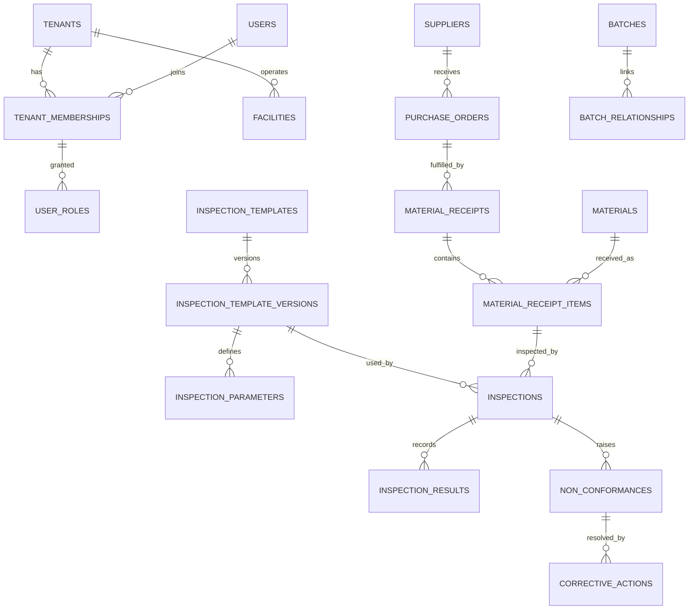

# Database Schema

> The migrations were consolidated into V1 to V11, one file per module, before the first deployment. The schema did not
> change. V numbers later in this document mean the original files, which remain in git history before that change.

`V1__foundation.sql` adds extensions, application role privileges and shared functions.
`V2__identity_and_tenancy.sql` adds the Phase 2 tables. Later phases below are the target design, and each
table is created by the phase that uses it.

## Conventions

- `id UUID PRIMARY KEY`, generated by the application as UUIDv7.
- Tenant-owned tables: `tenant_id UUID NOT NULL`, `UNIQUE (tenant_id, id)`, composite foreign keys and RLS.
- Standard columns: `created_at`, `updated_at` (`TIMESTAMPTZ`, with the `set_updated_at` trigger),
  `created_by`, `updated_by`, and `version BIGINT` for optimistic locking on mutable records.
- Status columns are `TEXT` with a `CHECK` constraint. Transitions are enforced in services.
- Records with history are never hard-deleted; they use `archived_at`.
- Names: `fk_`, `uq_`, `ix_`, `ck_` prefixes. Every foreign key is indexed, leading with `tenant_id`.
- `JSONB` is for configurable metadata only, never for values that are queried or reported on.

## Tables by phase

The brief's tables are included. **Bold** tables are additions, with the reason given.

### Phase 2: identity and tenancy
`tenants` (organisation profile, GSTIN, locale, timezone, currency), `users` (global, lowercase email: plain
`TEXT` with a `CHECK`, because JDBC-bound parameters can compare case-sensitively against `citext`),
`tenant_memberships` (user, tenant, status), `roles` (`tenant_id` NULL for system defaults), `permissions`,
`role_permissions`, `user_roles` (keyed to the membership, so that roles differ per organisation),
`audit_logs` (append-only for the application),
**`refresh_tokens`** (hash, family, expiry, for rotation and reuse detection).

### Phase 3: master data
`facilities`, `departments`, `attachments`, **`document_sequences`** (per-tenant numbering
for GRN, NCR, CAPA), `suppliers`, `supplier_contacts`, `product_categories`, `products`, `materials`,
`material_specifications`, `purchase_orders`, `purchase_order_items`, `material_receipts`,
`material_receipt_items`, **`units_of_measure`** (configurable UoM), **`production_lines`**, **`shifts`**,
**`supplier_categories`**, **`product_revisions`**, **`product_materials`** (mapping).

### Phase 4: inspection
`inspection_templates`, `inspection_template_versions` (status, effective dates, sampling plan, immutable once
published), `inspection_parameters`, `inspections`, `inspection_results` (one row per sample measured),
`inspection_approvals` (append-only decision history). Evidence uses `attachments`, with the parameter code as
its category. A sampling plan belongs to its version, so it cannot change once published.

Rules enforced in the database as well as in code:

- Triggers reject changes to published versions and their parameters (a version may only be superseded), to an
  inspection's specification, to results once submitted, and to any row of `inspection_approvals`.
- `disposition = 'ACCEPT'` requires `final_result = 'PASS'`, as a check constraint.
- `inspections.spec_snapshot JSONB` stores the full specification at execution time. It is one of the
  few legitimate JSONB uses: an immutable historical document.
- `inspection_results` keeps evaluation (`PASS`, `FAIL`, `PENDING_REVIEW`). Disposition (`ACCEPT`, `REJECT`,
  `HOLD`, `REWORK`, `CONDITIONAL_ACCEPTANCE`) is a separate column on `inspections`, and the two never mix.
- `actual_value` is stored as typed columns (`value_numeric NUMERIC(18,6)`, `value_text`, `value_boolean`,
  `value_date`) so results can be analysed.

### Phase 5: notifications and account email
`notifications`, **`notification_preferences`**, plus tables for invitations and for password reset and
email verification tokens, stored hashed like refresh tokens.

### Phase 6: quality issues
`non_conformances`, `corrective_actions`, `capa_actions`, `capa_verifications`, **`defect_categories`**,
**`ncr_status_history`**, **`capa_status_history`** (V6). Evidence uses `attachments`.

- Finished NCRs and CAPAs, status histories and verifications cannot be changed, enforced by triggers.
- One inspection has at most one NCR, by a partial unique index.
- `tenants_with_overdue_capas()` returns tenant ids only, on the same pattern as `tenants_with_pending_email()`.

### Phase 7: traceability
`production_batches`, `batch_relationships` (parent lot or batch, child batch and quantity: a directed graph walked
with recursive CTEs), `finished_products`, `dispatch_records`, **`dispatch_items`**, **`customers`** (V7). Received lots
stay in `material_receipt_items`, which gains `consumed_quantity`, so no separate `batches` table exists.

- `batch_relationships`, `dispatch_records` and `dispatch_items` cannot be changed, enforced by triggers. A mistake is
  reversed by a new row in **`trace_corrections`** (V8), which holds the reason. Each record can be reversed once.
- **`material_corrections`**, **`material_correction_items`** and **`material_correction_approvals`** (V9) keep the
  original and corrected values. Items and approvals are append-only, and a finished correction cannot be changed.
- **`dispatch_reversals`** and **`dispatch_reversal_items`** (V10) record returns. A return references the dispatch and
  never changes it. Stock comes back only when an inspection linked by `inspections.return_item_id` accepts the goods.
- Check constraints stop a lot or batch giving out more than it holds, and stop anything leaving an unreleased batch.
- `inspections` gains `production_batch_id`. Each inspection has exactly one subject, and a batch has one open inspection.

### Phase 8: calibration and audit
`instruments`, `calibration_records`, `audits`, `audit_checklists`, `audit_findings`,
**`audit_checklist_items`**, **`inspection_instruments`** (usage history).

### Phase 10: subscription
`subscription_plans` (`tenant_id`-free, prices editable by platform admins), `subscriptions`,
`subscription_invoices`, `payment_transactions`, **`plan_features`** (limits).

## Core relationships

Phase 3 note: supplier, material, product and receipt documents all live in `attachments`, linked by
`entity_type` and `entity_id`, so there is no `supplier_documents` table. `tenant_settings` moved to Phase 9.
Quantities, measurements and prices use `NUMERIC(18,6)`, and the API refuses values that would need rounding.

## Phase 5: notifications and account email (V5)

`notifications` (one row per recipient, with email delivery state and retry time), `notification_preferences`
(only where a user has changed a default), `invitations` (with the roles to grant) are tenant-owned and under
row-level security. `account_tokens` holds one-time password reset and email verification tokens; like
`refresh_tokens` it belongs to a user, not a tenant. `users.email_verified_at` is new.

- Every token is stored only as a SHA-256 hash.
- An invitation token carries its tenant id so that it can be looked up under that tenant's row-level security. The id
  grants nothing, because the hash must also be found in that tenant.
- `tenants_with_pending_email()` is `SECURITY DEFINER`. Together with `tenants_with_overdue_capas()` (V6) it is the only
  cross-tenant read in the application, and it returns tenant ids and nothing else. The `delivery_scan` policy that lets it see rows applies to the schema owner, never to
  the application role. The delivery job then reads each tenant's rows under that tenant's own context.

- **`email_delivery_logs`** (V12) has one row per delivery attempt. It is insert-only, and account emails have no tenant.
  `users.preferred_language` holds a person's email language. Tokens stay in `account_tokens` and email opt-outs in
  `notification_preferences`, so `email_verification_tokens` and `email_preferences` tables were not needed. Templates are
  files, so there is no `email_templates` table.
- **`dispatch_shipments`** (V13) is the append-only proof that goods physically left. Triggers refuse a cancellation of a
  shipped dispatch, a return on an unshipped one, and a shipment on a cancelled one. Dispatches from before V13 were
  backfilled as shipped unless already cancelled.
- **V14** adds `EXPECTED` and `CANCELLED` to return statuses, `corrective_actions.due_reminded_at`, and the tenant-id-only
  job functions `tenants_with_capas_due()` and `tenants_with_unconfirmed_dispatches()`.
- **V15** adds trigram and JSONB search indexes, contact columns on `customers`, `membership_facilities`, the `RECALL_*`
  permissions, `recalls`, `recall_batches`, `recall_contact_records`, the append-only `recall_contact_attempts` and
  `recall_acknowledgements`, the platform tables `scheduled_job_locks` and `scheduled_job_executions`, and
  `expire_unverified_accounts()`.
- **V16** adds `instruments`, the append-only `calibration_records` and `instrument_usages`, `audit_checklists`,
  `audit_checklist_items`, `audits`, `audit_items` (a copy of the questions, kept apart from later checklist changes),
  `audit_findings`, the `AUDIT_CLOSE` permission, and the audit source on `non_conformances`.
- **V20** adds `facility_id` to `non_conformances`, `corrective_actions` and `material_corrections`, filled from the inspection, audit, NCR, batch or lot behind each row.

## Phase 9: analytics (V17)

No new tables. Analytics read existing records through row-level security. V17 adds date indexes on decided
inspections, and on NCRs and CAPAs by creation and closure.

## Phase 10: subscriptions (V18, V19)

`subscription_plans` and `platform_admins` belong to the platform and have no `tenant_id`. The application role can read
`platform_admins` but not write it. `subscriptions` (one per tenant), `subscription_invoices` and `payment_transactions`
are tenant-owned with row-level security. An invoice copies its plan name, prices and buyer details, so that it never
changes afterwards. At most one invoice per tenant can be open, and a payment reference is unique per tenant and provider.

V21 adds `currency`, `public_visible` and `archived_at` to `subscription_plans`, and `subscription_plan_versions`, which

V22 adds `suspended_at` and `suspension_reason` to `tenants`, GST detail to `subscription_invoices`, and `method`, `paid_on` and `notes` to `payment_transactions`. Invoice and payment lists use `SECURITY DEFINER` functions that call `require_platform_admin()`, and renewal reminders skip suspended organisations.

V23 adds `max_storage_mb`, `max_monthly_inspections`, `max_attachments` and `feature_values` to `subscription_plans`, and the tables `feature_definitions` and `organisation_usage_snapshots`. The application role cannot read snapshots directly: `record_usage_snapshots()` writes them and `platform_usage_history()` reads them.
keeps each saved state of a plan. The application role can only add to that table. The `platform_*` functions that read
across organisations run as the schema owner and raise an error unless the current user is in `platform_admins`.
`platform_contracts_at` has no grant to the application role.

## Control Center operators (V24)

`platform_admins` gains `role`, `deactivated_at`, `added_by` and `reauthenticated_until`. Existing rows become
`SUPER_ADMIN`. The application role still cannot write this table: only `platform_operator_add`,
`platform_operator_change` and `platform_mark_reauthenticated` can, and each checks the caller at the database.
`email_delivery_logs.notification_id` links attempts to a notification. `subscription_invoices.overdue_notified_at`
keeps an invoice from being chased twice.

## Control Center console (V25)

`platform_settings` is a single row with no secrets. The application role can read it, and only
`platform_settings_save` can write it. `platform_announcements`, `support_tickets` and `support_notes` give the
application role no rights at all, and are reached through functions that check the operator. `support_tickets` and
`support_notes` also force row-level security, with a policy for the schema owner only.
