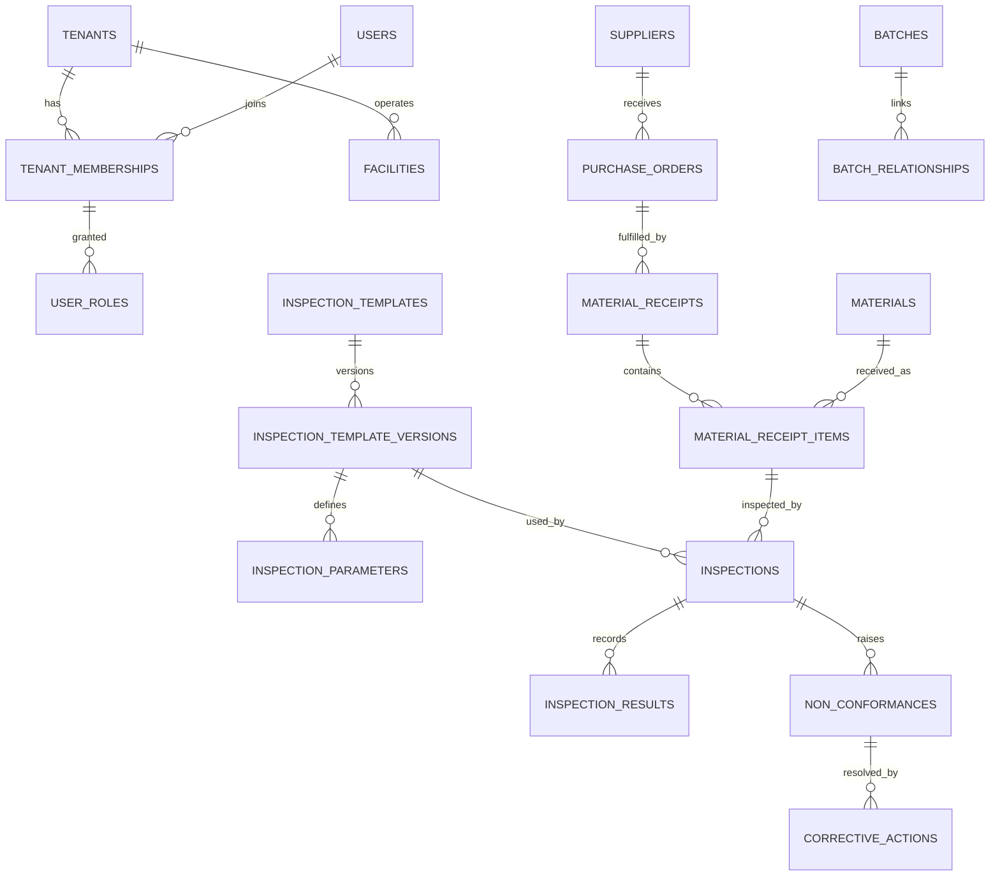

# Database Schema

`V1__foundation.sql` adds extensions, application role privileges and shared functions.
`V2__identity_and_tenancy.sql` adds the Phase 2 tables. Later phases below are the target design, and each
table is created by the phase that uses it.

## Conventions

- `id UUID PRIMARY KEY`, generated by the application as UUIDv7.
- Tenant-owned tables: `tenant_id UUID NOT NULL`, `UNIQUE (tenant_id, id)`, composite foreign keys and RLS.
- Standard columns: `created_at`, `updated_at` (`TIMESTAMPTZ`, with the `set_updated_at` trigger),
  `created_by`, `updated_by`, and `version BIGINT` for optimistic locking on mutable records.
- Status columns are `TEXT` with a `CHECK` constraint. Transitions are enforced in services.
- Records with history are never hard-deleted; they use `archived_at`.
- Names: `fk_`, `uq_`, `ix_`, `ck_` prefixes. Every foreign key is indexed, leading with `tenant_id`.
- `JSONB` is for configurable metadata only, never for values that are queried or reported on.

## Tables by phase

The brief's tables are included. **Bold** tables are additions, with the reason given.

### Phase 2: identity and tenancy
`tenants` (organisation profile, GSTIN, locale, timezone, currency), `users` (global, lowercase email: plain
`TEXT` with a `CHECK`, because JDBC-bound parameters can compare case-sensitively against `citext`),
`tenant_memberships` (user, tenant, status), `roles` (`tenant_id` NULL for system defaults), `permissions`,
`role_permissions`, `user_roles` (keyed to the membership, so that roles differ per organisation),
`audit_logs` (append-only for the application),
**`refresh_tokens`** (hash, family, expiry, for rotation and reuse detection).

### Phase 3: master data
`facilities`, `departments`, `tenant_settings`, `attachments`, **`document_sequences`** (per-tenant numbering
for GRN, NCR, CAPA), `suppliers`, `supplier_contacts`, `supplier_documents`, `product_categories`, `products`, `materials`,
`material_specifications`, `purchase_orders`, `purchase_order_items`, `material_receipts`,
`material_receipt_items`, **`units_of_measure`** (configurable UoM), **`production_lines`**, **`shifts`**,
**`supplier_categories`**, **`product_revisions`**, **`product_materials`** (mapping).

### Phase 4: inspection
`inspection_templates`, `inspection_template_versions` (status, effective dates, immutable once published),
`inspection_parameters`, `inspection_sampling_plans`, `inspections`, `inspection_results`,
`inspection_approvals`, `inspection_attachments`, `notifications`,
**`inspection_samples`** (one row per sample measured), **`notification_preferences`**.

Rules enforced in the database as well as in code:

- A trigger rejects `UPDATE` and `DELETE` on versions and parameters of a published template.
- `inspections.spec_snapshot JSONB` stores the full specification at execution time. It is one of the
  few legitimate JSONB uses: an immutable historical document.
- `inspection_results` keeps evaluation (`PASS`, `FAIL`, `PENDING_REVIEW`). Disposition (`ACCEPT`, `REJECT`,
  `HOLD`, `REWORK`, `CONDITIONAL_ACCEPTANCE`) is a separate column on `inspections`, and the two never mix.
- `actual_value` is stored as typed columns (`value_numeric NUMERIC(18,6)`, `value_text`, `value_boolean`,
  `value_timestamp`) so results can be analysed.

### Phase 5: quality issues
`non_conformances`, `ncr_attachments`, `corrective_actions`, `capa_actions`, `capa_verifications`,
**`defect_categories`**, **`ncr_status_history`**, **`capa_status_history`**.

### Phase 6: traceability
`batches`, `batch_relationships` (parent, child, quantity: a directed graph walked with recursive CTEs),
`production_batches`, `finished_products`, `dispatch_records`, **`customers`** (dispatch needs a recipient).

### Phase 7: calibration and audit
`instruments`, `calibration_records`, `audits`, `audit_checklists`, `audit_findings`,
**`audit_checklist_items`**, **`inspection_instruments`** (usage history).

### Phase 9: subscription
`subscription_plans` (`tenant_id`-free, prices editable by platform admins), `subscriptions`,
`subscription_invoices`, `payment_transactions`, **`plan_features`** (limits).

## Core relationships

